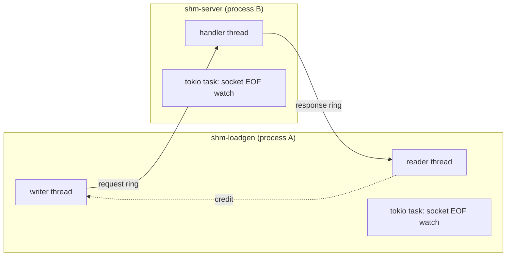

# shm-ring POC plan

## Status

All six steps are done. 19 tests pass, `cargo clippy --all-targets` reports zero warnings under the seed lints.

Release build, 5,000,000 requests, 64-byte payload, WSL2 on 20 cores:

| `--max-in-flight` | Throughput | p50 round trip | p99 round trip |
| ----------------- | ---------- | -------------- | -------------- |
| 1                 | 2.5 M/s    | 258 ns         | 384 ns         |
| 64                | 11.0 M/s   | 748 ns         | 8.8 µs         |
| 1024              | 11.0 M/s   | 14.4 µs        | 131 µs         |

## Run it

These are fish commands, run from `stuff/shm-ring-poc/`.

```fish
cargo nextest run
cargo build --release
./target/release/shm-server &
./target/release/shm-loadgen --requests 5000000 --max-in-flight 64
kill %1
```

`RUST_LOG=trace` shows every park and wake.

## Decisions

| Topic            | Choice                                                                                       |
| ---------------- | -------------------------------------------------------------------------------------------- |
| Wake-up          | Spin, then futex on a word in the shared region                                              |
| Sharing          | `memfd_create` plus `SCM_RIGHTS` over `/tmp/shared.socket`                                   |
| Syscalls         | `rustix` 1.1.6                                                                               |
| Crates           | `tokio` 1.54.1, `tracing` 0.1.44, `tracing-subscriber` 0.3.23, `clap` 4.6.7, `color-eyre` 0.6.5, `thiserror` 2.0.21 |
| Dev crates       | `pretty_assertions` 1.4.1                                                                    |
| Toolchain        | Rust 1.99.1, edition 2024, resolver 3, lints and configs copied from `rust-seed`             |
| Errors           | `thiserror` for `RegionError` and `LoadError` and the ring errors, `eyre` for the server and the binaries |

## Defaults picked without asking

React to any of these.

1. The workspace has one crate `shm-ring` with a library and two binaries, `shm-server` (process B) and `shm-loadgen` (process A). Integration tests can only spawn binaries of their own package through `CARGO_BIN_EXE_*`.
2. Process A creates the memfd. A knows `--max-in-flight` and `--payload-size`, so A sizes the region, writes the header, and sends the fd. B maps it, validates the header, and replies with one ack byte. No config struct crosses the socket.
3. Slots have a fixed size. Each slot holds a 24-byte header (`id`, `sent_at_ns`, `len`) and the payload, rounded up to 64 bytes.
4. Ring capacity is the next power of two at or above `--max-in-flight`. A producer can therefore never find its ring full. A full ring is an invariant violation and returns an error instead of blocking. The invariant depends on release order, see [Release order](#release-order).
5. B handles requests on one thread in arrival order. A response is the request with its payload reversed. A asserts that ids arrive as 0, 1, 2, ... and checks every payload.
6. The Unix socket stays open after the handshake as a liveness channel. EOF on it aborts the region and wakes every parked thread. The hot path never touches the socket.
7. `shm-loadgen` retries `connect` until `--connect-timeout`, so start order does not matter.

## Memory layout

Every field lives at an offset from the mapping base. The region holds no pointers.

```text
+--------------------------------------------------+ 0
| RegionHeader: magic, version, capacity,          |
|   slot_size, request/response offsets, length    |
+--------------------------------------------------+ 128
| RingHeader (requests)                            |
|   tail          (own 128-byte line, A writes)    |
|   head          (own 128-byte line, B writes)    |
|   data_ready    (own 128-byte line, futex word)  |
|   state         (own 128-byte line, open/closed/ |
|                  aborted)                        |
| slots[capacity]                                  |
+--------------------------------------------------+
| RingHeader (responses), same shape, B -> A       |
| slots[capacity]                                  |
+--------------------------------------------------+
```

The kernel zero-fills a new memfd. Zero is the valid initial state of every field: empty ring, awake waiter, open state.

## Threads



## In-flight cap

1. The writer computes `in_flight = sent - received` before each send.
2. When `in_flight` equals the cap, the writer parks on a process-local credit wait cell.
3. The reader increments `received` after each response and notifies the credit wait cell.

## Park and wake protocol

```text
consumer                              producer
state = PARKED                        publish tail (Release)
fence(SeqCst)                         fence(SeqCst)
recheck ring, return if ready         if state == PARKED
futex_wait(state, PARKED)                 swap state to AWAKE
state = AWAKE                             futex_wake(state, 1)
```

The two `SeqCst` fences guarantee that at least one side observes the other side's store, so a wake-up cannot get lost. Under load the consumer never parks and the producer never calls `futex_wake`, so the steady state makes zero syscalls.

## Release order

A producer writes in place through `reserve()` and publishes with `commit()`. A consumer reads in place through `recv()` and frees the slot with `release()`, or by dropping the guard.

1. B releases request N before it commits response N. If B committed first, A could receive response N and send request N + cap while request N still held its slot. The request ring would then hold cap + 1 messages. The `max_in_flight = 1` integration test caught exactly this.
2. A's reader releases response N before it grants credit. Otherwise the writer could send a request whose response finds the response ring full.

## Shutdown

1. Graceful: dropping the request producer closes the request ring after the last request. B drains it and drops the response producer. A's reader drains the response ring and then sees `Closed`. A then drops the socket.
2. Crash: socket EOF in either process sets `ABORTED` on both rings and wakes every parked thread. Pending messages are discarded.

## Tests

Unit tests:

1. Ring FIFO across two threads, 1,000,000 messages, many wraparounds
2. `reserve` on a full ring returns `Full`, and a slot stays claimed until its guard is released
3. An uncommitted reservation publishes nothing
4. Closing a ring lets the consumer drain the remaining messages before `Closed`
5. Aborting a ring wakes a parked consumer
6. Wait cell ping-pong between two threads, 20,000 rounds with spin 0, no lost wake-up
7. Region header validation rejects a bad magic, version, and length
8. Two mappings of one memfd share the rings
9. fd passing over a socket pair, both mappings observe the same bytes
10. Payload pattern and latency percentile helpers

Integration tests (`tests/load.rs`):

1. Spawn `shm-server`, run the load generator in-process, 200,000 requests, assert count, order, and in-flight cap
2. Slow server (`--handle-delay-ns`), cap 8, assert the observed maximum in-flight equals 8
3. Three sequential clients with caps 1, 16, and 1024 against one server
4. Spawn both binaries, assert `shm-loadgen` exits successfully
5. Kill `shm-server` mid-run, assert the load generator returns `LoadError::Aborted` instead of hanging

## Steps

1. Scaffold the workspace from `rust-seed`
2. `wait.rs` and `ring.rs` with unit tests
3. `region.rs` and `handshake.rs` with unit tests
4. `server.rs`, `loadgen.rs`, both binaries, tracing setup
5. Integration tests
6. Clean `cargo clippy` under the seed lints
